<div align="center">

  

  <p align="center">
    <a href="https://github.com/saffronsarb">
      
    </a>
    <a href="https://shooliniuniversity.com">
      
    </a>
    <a href="#-building-intelligent-systems">
      
    </a>
  </p>

</div>

**👨‍💻 `saffron.config.json`**

```json
{
  "developer": "Saffron Singh", "education": "B.Tech CSE — Shoolini University",
  "focus": ["Systems Engineering", "OS Architecture", "Algorithms", "AI/ML"],
  "current_work": "System-level programming, OS architecture & Algorithms",
  "creed": "Build → Break → Understand → Improve."
}
```

---

## ⭐ Featured Projects

| Project | Description | Stack |
| :--- | :--- | :--- |
| [**AI Enterprise Knowledge Manager** ↗](https://github.com/saffronsarb/SDK-OpenAI-7-agents-Project-with-Orchestration-) | 7-agent hub-and-spoke knowledge management system built with OpenAI Agents SDK and Pydantic for deterministic, multi-turn execution. *(IIT Jammu Summer School 2026)* | `Python` • `OpenAI Agents SDK` • `Pydantic v2` • `Multi-Agent Orchestration` • `RAG` |
| [**FinPilot AI** ↗](https://github.com/saffronsarb/FinPilot-AI) | Full-stack finance companion using React, Express, and Google Gemini to convert natural-language expenses into validated database transactions. | `TypeScript` • `React` • `Vite` • `Node.js` • `Express` • `SQLite` • `Google Gemini API` • `Zod` |
| [**Generative AI & Deep Learning Experiments** ↗](https://github.com/saffronsarb/Generative-AI-Saffron-) | Reproducible Jupyter notebooks exploring convolutional autoencoders, image denoising, and foundational machine learning workflows in Python. | `Python` • `Jupyter Notebook` • `Deep Learning` • `Autoencoders` • `Computer Vision` |
| [**C++ Programming Foundations** ↗](https://github.com/saffronsarb/Safi_cpp_programs) | Collection of C++ implementations focusing on core algorithms, object-oriented programming, and foundational memory mechanics. | `C++` • `Object-Oriented Programming` • `Algorithms` • `Data Structures` |

---

## 🛠️ Technical Stack

<div align="center">

**AI & Machine Learning**<br>
    <br>
**Programming & Web Backend**<br>
<a href="https://skillicons.dev"></a><br>
**Tools & Environments**<br>
<a href="https://skillicons.dev"></a><br>
**🔭 Exploring Next & Current Focus**<br>
   

</div>

---

## 🧠 Systems & Intelligent Engineering

<table>
  <tr>
    <td width="50%" valign="top">
      <b>⚙️ Systems & Architecture</b><br>
      Diving deep into Operating Systems, low-level architecture, and algorithmic optimization.
    </td>
    <td width="50%" valign="top">
      <b>🤖 Multi-Agent Systems</b><br>
      Building specialized agents coordinated through orchestration and structured handoffs.
    </td>
  </tr>
  <tr>
    <td width="50%" valign="top">
      <b>🔍 RAG & Grounded AI</b><br>
      Exploring retrieval-based systems that connect LLM responses to real domain knowledge.
    </td>
    <td width="50%" valign="top">
      <b>📐 Structured AI</b><br>
      Using schemas and validation to make model outputs predictable and application-ready.
    </td>
  </tr>
  <tr>
    <td colspan="2" valign="top">
      <b>⚡ AI Automation:</b> Exploring event-driven workflows and AI automation with tools such as n8n.
    </td>
  </tr>
</table>

---

## 🤝 Connect

<div align="center">

*"Build → Break → Understand → Improve."*  
*"Don't just use AI. **Understand the engineering beneath it.**"*

<br>

[](https://github.com/saffronsarb)
[](https://www.linkedin.com/in/saffron-singh-851a44415/)
[](mailto:ssaffron533@gmail.com)

<br>

<sub>Saffron Singh • B.Tech Computer Science (AI &amp; ML) • Shoolini University, Solan, India</sub>

</div>
